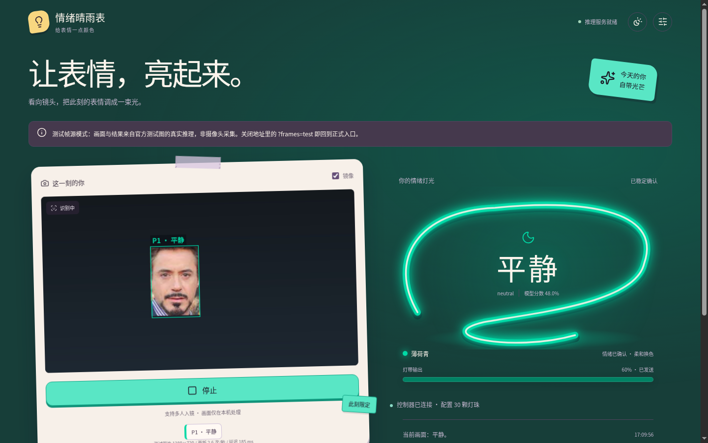

# 情绪晴雨表 (Emotion Barometer)

[](https://spacemit.com)
[-E95420?logo=ubuntu&logoColor=white)](https://archive.spacemit.com)
[](https://www.python.org)
[](docs/controller.md)

情绪晴雨表是运行在 SpacemiT K3 上的软硬件联动演示项目。连接普通 USB 摄像头与 WLED 灯带后，K3 会在本地实时分析人脸表情，让网页界面与桌面实体灯带随着镜头前大家的情绪变化同步变色。

### 它能做什么

* **本地实时识别人脸情绪**：人脸检测（YOLOv5-Face）与情绪分类（HSEmotion / 官方模型）均在 K3 本地运行，不依赖云端。支持在网页设置中实时热切换模型，直观对比不同模型的识别表现。
* **物理灯带与网页同步联动**：通过 USB 串口以 Adalight 协议控制 60 颗 WLED 实体 RGB 灯带，前端页面实时同步灯光渲染与过渡轨迹，把边缘视觉推理转化为直观的环境光交互。
* **多人同框与空间分区渐变**：多人入镜时，算法按画面中的左右方位自动为灯带分配空间区间；当大家表情一致时，灯光还会协同提升亮度。

---

## 快速上手

### 1. 软件环境与模型

运行环境为 Bianbu 4.0.3 riscv64，要求 Python 3.14.4 与 uv。

```bash
# 创建虚拟环境
~/.local/bin/uv venv .venv --python /usr/bin/python3.14
source .venv/bin/activate

# 安装 SpacemiT OpenCV 5.0 系统库（安装至 /opt/opencv-spacemit）
sudo apt update
sudo apt install opencv-spacemit=5.0.0-1bb1

# 安装 Python 依赖并校验 Vision 扩展
~/.local/bin/uv pip install --python .venv/bin/python \
  --index-url https://git.spacemit.com/api/v4/projects/33/packages/pypi/simple \
  -r requirements.txt

# 下载并校验模型权重
.venv/bin/python scripts/download_models.py
```

### 2. 硬件连接与配置

将 USB 摄像头与 WLED-Controller-S2（固件 WLED 0.15.1，接 60 颗 RGB 灯带）接入 K3 的 USB 端口。

首次连接时配置串口访问权限：

```bash
sudo usermod -aG dialout bianbu
```

重新登录会话使组权限生效，执行 `id` 确认包含 `dialout`。核对 [configs/light.json](configs/light.json) 中的串口路径与实际设备一致。

控制器出厂默认若配置为 30 颗，可通过 [prepare-wled.md](docs/prepare-wled.md) 一次性将配置更新为 60 颗。日常无需重复配置。

### 3. 运行 Demo

```bash
./run.sh
```

在 K3 浏览器中打开 `http://127.0.0.1:8321/`，点击开始体验。
* 摄像头开启实时检测与表情分类。
* 网页与实体灯带同步显示情绪色彩与过渡动画。
* 页面停止按钮释放摄像头并使灯带恢复待机光；终端按 Ctrl-C 退出服务。

## 自动化检查

执行统一检查脚本，验证灯光规则、模型接口、页面交互及硬件通信：

```bash
./run_test.sh
```

运行报告与日志生成在 `tests/output/latest/` 目录。离线检查代码逻辑可执行 `./run_test.sh --unit`；无硬件接入时可执行 `./run_test.sh --no-hardware`。

## 目录结构

| 路径 | 用途 |
| --- | --- |
| `server/`、`configs/` | 后端服务、推理链路与模型配置 |
| `web/` | 前端界面、灯效渲染与测试帧 |
| `scripts/` | 模型下载校验与控制器配置脚本 |
| `run_test.sh`、`tests/` | 自动化测试入口、用例与报告 |
| `docs/controller.md` | 控制器接线、串口通信与电流分档说明 |
| `docs/development.md` | 数据流、API 接口、时序规则与开发指南 |
| `licenses/` | 第三方许可与引用来源 |

## 界面示例

下图为使用测试图片经 B0 模型推理的实际界面效果：



移动端界面参考 [移动端设置示例](docs/images/mobile-settings.png)。第三方版权信息见 [许可说明](licenses/README.md)。
